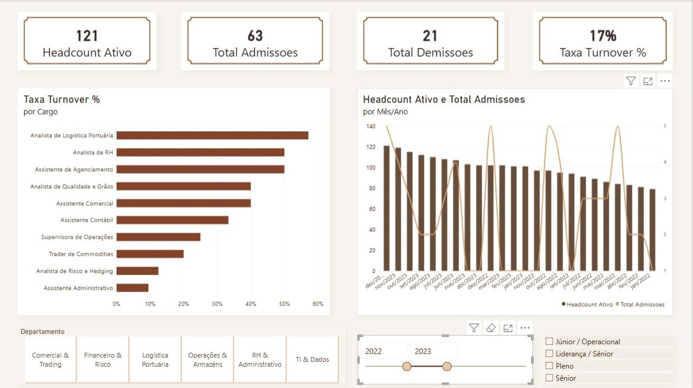

# 📊 Dashboard de People Analytics & Retenção de Talentos — SoyBean Trading Corp

Este repositório contém o dashboard interativo de **People Analytics** desenvolvido no **Power BI** para a **SoyBean Trading Corp** (empresa fictícia do setor do agronegócio). O objetivo principal do projeto é monitorar indicadores estratégicos de RH, como **Headcount Ativo**, **Taxa de Turnover %**, **Admissões vs. Desligamentos** e **Análise de Tenure (Tempo de Casa)**.

---

## 📁 Estrutura desta Pasta (`/dashboard`)

```text
dashboard/
├── fotos/
│   ├── pagina1_visao_geral.png         # Captura de tela da Página 1
│   └── pagina2_diagnostico_retencao.png # Captura de tela da Página 2
├── Dashboard_People_Analytics.pbix     # Arquivo do relatório no Power BI
├── Relatorio_People_Analytics.pdf      # Exportação do dashboard em PDF
└── README.md                           # Documentação da pasta
```

> 💡 **Nota:** Para que as imagens apareçam corretamente neste `README.md`, renomeie as imagens dentro da pasta `fotos` para `pagina1_visao_geral.png` e `pagina2_diagnostico_retencao.png` (ou ajuste os nomes no código do README).

---

## 🖼️ Visualização do Dashboard

### Página 1: Visão Geral de Turnover & Headcount


* **Cartões de KPI:** Headcount Ativo, Total de Admissões, Total de Demissões e Taxa de Turnover (%).
* **Evolução do Quadro:** Gráfico comparativo de crescimento do Headcount ao longo do tempo vs. ocorrência de desligamentos.
* **Análise Setorial:** Distribuição da taxa de turnover por Departamento/Área.
* **Filtros Dinâmicos:** Filtros por Ano, Departamento e Gênero.

---

### Página 2: Diagnóstico de Retenção & Motivos de Saída


* **Tipo de Desligamento:** Proporção entre saídas Voluntárias (pedidos de demissão) e Involuntárias (desligamentos pela empresa).
* **Análise de Causas:** Principais motivos alegados para o desligamento (*Exit Interview*).
* **Tempo de Empresa (*Tenure*):** Distribuição dos desligamentos por faixa de permanência (< 90 dias, 3 meses a 1 ano, 1 a 3 anos, > 3 anos).
* **Tabela Analítica:** Detalhamento individual para consulta rápida do RH.

---

## 🛠️ Arquitetura e Modelagem de Dados

A solução foi construída utilizando o modelo dimensional **Star Schema (Esquema Estrela)**:

* **Tabela Fato (`dados_rh_soybean_corp`):** Registros de colaboradores (Admissão, Demissão, Cargo, Departamento, Motivo de Saída).
* **Tabela Dimensão (`dCalendario`):** Tabela contínua de datas para análises temporais completas.
* **Tabela de Suporte (`_Medidas`):** Concentração de todas as regras de negócio e cálculos DAX.

### Relacionamentos entre Tabelas:
1. `dCalendario[Date]` $\rightarrow$ `dados_rh_soybean_corp[Data_Admissao]` (**Ativo — 1:N**)
2. `dCalendario[Date]` $\rightarrow$ `dados_rh_soybean_corp[Data_Demissao]` (**Inativo — 1:N**)

---

## 📐 Principais Fórmulas DAX Utilizadas

### 1. Headcount Ativo
Calcula o número exato de colaboradores ativos em qualquer data de corte selecionada no filtro:
```dax
Headcount Ativo = 
VAR DataFim = MAX(dCalendario[Date])
RETURN
CALCULATE(
    COUNT(dados_rh_soybean_corp[ID_Colaborador]),
    dCalendario[Date] <= DataFim,
    ISBLANK(dados_rh_soybean_corp[Data_Demissao]) || dados_rh_soybean_corp[Data_Demissao] > DataFim
)
```

### 2. Total de Demissões (Relacionamento Inativo)
Ativa temporariamente a ligação com a *Data de Demissão* para contabilizar os desligamentos do período:
```dax
Total Demissoes = 
CALCULATE(
    COUNT(dados_rh_soybean_corp[ID_Colaborador]),
    USERELATIONSHIP(dados_rh_soybean_corp[Data_Demissao], dCalendario[Date]),
    dados_rh_soybean_corp[Status] = "Desligado"
)
```

### 3. Taxa de Turnover (%)
```dax
Taxa Turnover % = 
VAR Demissoes = [Total Demissoes]
VAR HeadcountAtual = [Headcount Ativo]
RETURN
DIVIDE(Demissoes, HeadcountAtual, 0)
```

### 4. Faixa de Tempo de Casa (Coluna Calculada)
```dax
Faixa Tempo Casa = 
VAR DataFinal = IF(ISBLANK(dados_rh_soybean_corp[Data_Demissao]), DATE(2025, 12, 31), dados_rh_soybean_corp[Data_Demissao])
VAR Dias = DATEDIFF(dados_rh_soybean_corp[Data_Admissao], DataFinal, DAY)
RETURN
SWITCH(
    TRUE(),
    Dias <= 90, "1. Até 90 dias (Precoce)",
    Dias <= 365, "2. 3 meses a 1 ano",
    Dias <= 1095, "3. 1 a 3 anos",
    "4. Mais de 3 anos"
)
```

---

## 💡 Principais Diagnósticos de Negócio
1. **Early Turnover (< 90 dias):** Mapeamento do percentual de desligamentos precoces para sinalizar oportunidades no processo seletivo e *onboarding*.
2. **Desligamentos Voluntários:** Identificação dos principais motivos alegados por ex-colaboradores para orientar pesquisas de clima e políticas salariais.
3. **Visão por Área:** Destaque para departamentos com alta rotatividade relativa para atuação focada da liderança.

---

## 🧰 Tecnologias e Ferramentas
* **Power BI Desktop** (Modelagem Dimensional, DAX, Visualização de Dados)
* **Tema JSON Customizado** (Identidade visual em tons terrosos e dourados voltada ao agronegócio)
* **Git & GitHub** (Versionamento e documentação)
